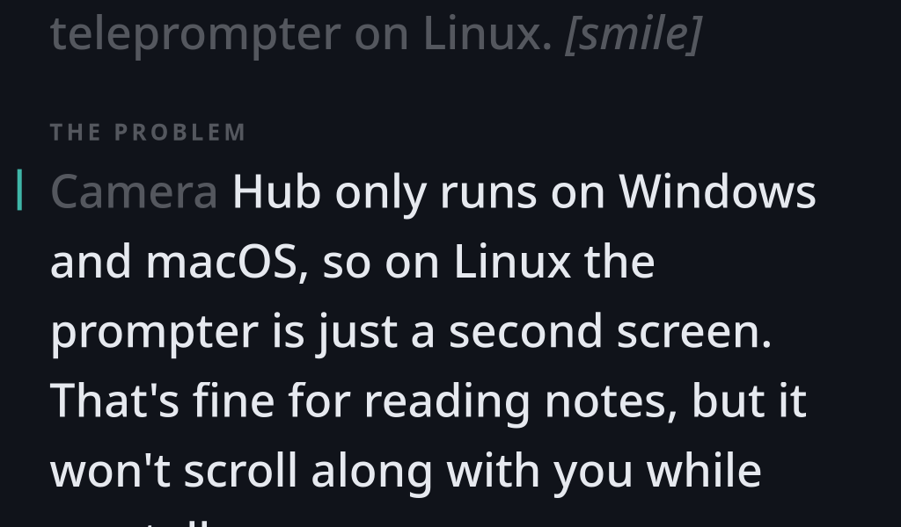
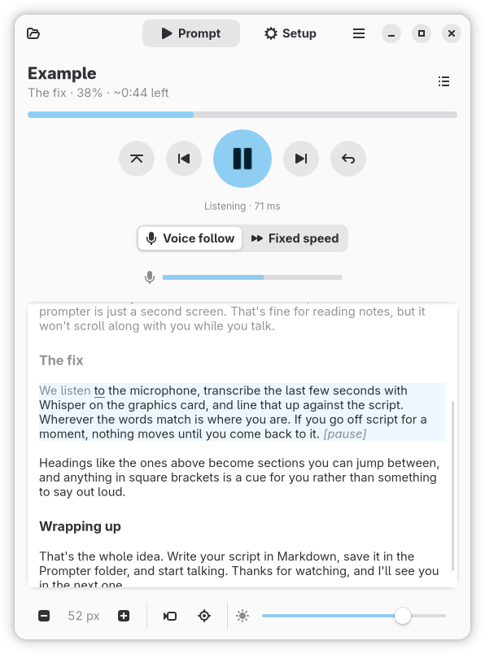

# Prompter

A voice-following teleprompter for the **Elgato Prompter** on Linux.

Elgato's Camera Hub, which drives the Prompter's teleprompter features, only runs on
Windows and macOS. On Linux the Prompter is just a small second screen. Prompter fills
the gap: it shows your script on the Prompter and scrolls it **as you speak**, using local
speech recognition, or at a steady speed if you prefer.

- **Voice follow.** Listens to your mic, transcribes the last few seconds with Whisper
  several times a second, and keeps the line you're on at the reading line. Ad-libs don't
  move it; re-reading a line moves it back.
- **Scripts are Markdown files.** Headings become sections you can jump between,
  `[cues]` are shown but never expected to be spoken, `<!-- comments -->` are hidden. Edits
  show up as soon as you save.
- **Eye-line crosshair** over the camera lens, with a "Find the lens" mode that blacks out
  the screen so you can see the lens through the glass.
- **Camera self-view** in a corner of the Prompter.
- **A timer and progress** on the Prompter: reading time, time left or the time of day, and
  how far through the script you are, in whichever corner or edge suits you.
- **The Prompter's brightness and contrast**, set from the app (DDC/CI, as Camera Hub does).
- **Global shortcuts** through your desktop's shortcuts portal, plus `prompterctl` for
  anything else.

<p align="center">
  
  
</p>

Not affiliated with or endorsed by Elgato or Corsair.

## Requirements

- An **Elgato Prompter**, with the **DisplayLink driver** for Linux (`evdi` plus
  DisplayLink Manager) installed and running.
- A **Wayland** desktop: GNOME, KDE Plasma, Hyprland, Sway and others.
- An **NVIDIA GPU is recommended** for voice follow. Without one it runs on the CPU with
  a smaller model, which tracks less closely.
- **PipeWire** (`pw-record`, `pactl`) and **ffmpeg** (for the camera self-view).
- **Python 3.11+**, **GTK 4.12+**, **libadwaita 1.8+** and **PyGObject**, from your
  distribution:
  - Arch: `sudo pacman -S python-gobject gtk4 libadwaita ffmpeg python-pipx`
  - Fedora 43+: `sudo dnf install python3-gobject gtk4 libadwaita ffmpeg pipx`
  - Debian 14 / Ubuntu 25.10+: `sudo apt install python3-gi gir1.2-gtk-4.0 gir1.2-adw-1 ffmpeg pipx`

## Install

```sh
pipx install --system-site-packages "prompter[cuda] @ git+https://github.com/DanielHouston/prompter"
prompter --install-desktop
```

Leave out `[cuda]` if you don't have an NVIDIA GPU. `--system-site-packages` lets it use
your distribution's GTK bindings. `--install-desktop` adds Prompter to your app launcher,
and your desktop needs that entry before it will grant global shortcuts.

The first time voice follow starts it downloads its speech model to
`~/.cache/huggingface`: about 1.5 GB on a GPU, less on the CPU.

## Using it

Start **Prompter** from your launcher. The script appears fullscreen on the Prompter by
itself. The control window opens on your current screen:

- **Prompt** is for while you read. It has start/pause, section jumps, voice follow or
  fixed speed, how far through you are and roughly how long is left, and the script
  itself: click anywhere to jump there. A quick bar holds text size, self-view, crosshair,
  timer, progress and brightness.
- **Setup** holds everything you set once: microphone, language, speech model, text style,
  crosshair, camera, timer, progress, brightness and diagnostics.

Closing the control window doesn't stop Prompter: it stays in your tray (KDE Plasma, waybar
and most other bars; GNOME needs the AppIndicator extension). Click the tray icon to bring
the controls back, middle-click it to start or pause, and quit from its menu.

Scripts live in `~/Documents/Prompter` by default (Setup → Script → Scripts folder →
**Change…** to use another folder). A welcome script is there the first time. The folder
button in the header bar lists your scripts, and Setup can show the folder in your file
manager.

```markdown
# Intro

Hi everyone, welcome back. [smile]

<!-- remember to check the mic -->

## Today's topic

Each heading is a section. Text in square brackets is a cue for you, not something to say.
```

Voice follow works for languages that separate words with spaces. Pick yours under Setup →
Voice follow → Language.

### Shortcuts

Prompter registers its actions with your desktop's **global shortcuts portal**, so they
work while you're in another app:

- **KDE Plasma and GNOME** ask you to confirm or assign keys the first time.
- **Hyprland** lists them in `hyprctl globalshortcuts`; bind the keys you want in your
  config:

  ```lua
  -- hyprland.lua
  hl.bind("SUPER + ALT + space", hl.dsp.global("io.github.DanielHouston.Prompter:toggle"))
  ```
  ```ini
  # hyprland.conf
  bind = SUPER ALT, space, global, io.github.DanielHouston.Prompter:toggle
  ```

- **Anything else**: bind keys to `prompterctl <action>`. It starts Prompter if needed.

The actions are `toggle`, `mode`, `next-section`, `prev-section`, `back`, `restart`,
`faster`, `slower`, `bigger`, `smaller`, `preview`, `timer`, `progress` and `control`. The
menu's **Keyboard Shortcuts** shows what's bound. The same keys without modifiers (Space, V,
Page Up/Down, Backspace, Home, [ ], − =, C, T, %) work in the control window's Prompt tab.

### Prompter brightness

The DisplayLink driver exposes the Prompter's DDC/CI channel as an I2C bus. To let the app
use it, without root, run this once:

```sh
echo 'SUBSYSTEM=="i2c-dev", ATTR{name}=="DisplayLink I2C Adapter", TAG+="uaccess"' \
  | sudo tee /etc/udev/rules.d/70-elgato-prompter-ddc.rules
echo i2c-dev | sudo tee /etc/modules-load.d/i2c-dev.conf
sudo udevadm control --reload && sudo modprobe i2c-dev
```

Only the Prompter's bus is opened up, not your GPU's.

## Troubleshooting

- **"Elgato Prompter not found":** check the DisplayLink service is running
  (`systemctl status displaylink`), then reconnect the Prompter.
- **The Prompter stays black on Hyprland with an NVIDIA GPU.** This is a Hyprland
  limitation: it can't yet hand NVIDIA-rendered frames to DisplayLink displays. The fix is
  in progress in [hyprwm/aquamarine#279](https://github.com/hyprwm/aquamarine/pull/279).
  KDE Plasma and GNOME work today.
- **Voice follow lags:** Setup → Voice follow shows whether the model runs on the GPU or
  the CPU. On the CPU, "Small" models keep up best.
- The speech engine logs to `~/.cache/prompter/asr.log`.
- **Bug reports about tracking:** turn on Setup → Diagnostics → *Save sessions for
  tuning*, read the part that goes wrong, and attach the session folder from
  `~/.cache/prompter/sessions`.

## Privacy

Everything runs on your machine. Your voice is never sent anywhere; the only network
access is downloading a speech model the first time it's needed (from Hugging Face). Session recordings are off unless you turn
them on, stay local, and can be deleted from Setup.

## Development

```sh
python -m venv --system-site-packages .venv
.venv/bin/pip install -e ".[cuda]"
.venv/bin/prompter
python -m unittest discover -s tests
```

## License

GPL-3.0-or-later. See [LICENSE](LICENSE).

Elgato is a trademark of Corsair Memory, Inc. This project is not affiliated with,
endorsed by or sponsored by Elgato or Corsair.
